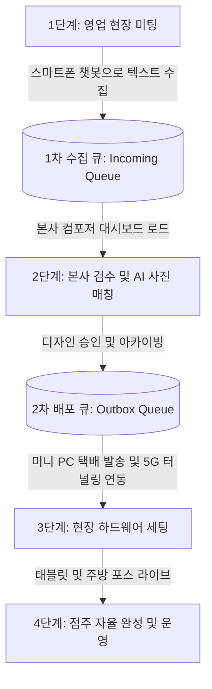

# 🚀 Starlink B2B POS SaaS 1차 전개 마스터플랜 (Master Deployment Plan)

본 문서는 스타링크(Starlink) 스마트 오더링 및 실시간 QR 매장 주문 시스템의 **1차 상용화 및 현장 전개(Deployment)를 위한 종합 마스터플랜**입니다. 
영업 현장 수집부터 본사 검수, 미니 PC 배포, 그리고 점주 자율 완성에 이르는 전체 생애주기(Lifecycle)와 기술 아키텍처를 정의합니다.

---

## 1. 🎯 프로젝트 개요 및 비즈니스 목표
* **목표**: 전국 수천 개 가맹점(카페, 식당, 중식당, 주점 등)을 중앙 클라우드에서 병목 없이 관리하고, 영업맨-본사-가맹점 주인이 유기적으로 협업하여 1일 내 매장 오픈을 완료하는 B2B SaaS 체계 구축.
* **핵심 가치**:
  1. **오프라인-우선(Offline-First) 영업**: 인터넷 제약 없는 스마트폰 챗봇을 통한 1분 메뉴 수집.
  2. **듀얼 스테이지 큐(Dual-Stage Queue) 관제탑**: 본사 디자인/기술팀의 체계적인 검수 및 배포 대기열 관리.
  3. **제로-터치(Zero-Touch) 하드웨어 프로비저닝**: 범용 미니 PC 사전 양산 및 5G 터널링(Cloudflare) 원격 연동.
  4. **점주 자율 완성(Self-Service Customization)**: 현장 설치 후 점주가 직접 매장 특성에 맞게 사진 및 메뉴 디테일 완성.

---

## 2. 🔄 4단계 실전 전개 생애주기 (Workflow)

### [1단계] 영업맨 현장 미팅 및 텍스트 수집 (참의 값 확보)
* **도구**: 모바일 웹 기반 영업맨 미팅 챗봇 (`rep_meeting_assistant.html`)
* **프로세스**:
  1. 영업맨이 스마트폰 브라우저로 접속하여 사원 인증(`REP_KIM_07` 등)을 수행합니다.
  2. 점주와 대화하며 상호명(`홍대 바삭한 숯불구이`)과 업종(`RESTAURANT`)을 확정합니다.
  3. 점주가 불러주는 메뉴명과 가격을 대화형으로 입력합니다. (예: `식사류 얼큰차돌된장찌개 9000`)
  4. 미팅 직후 **[☁️ 본사 전송]** 버튼을 눌러 데이터가 본사 파이어베이스(Firebase Firestore) **1차 수집 큐**로 적재됩니다. (네트워크 불가 시 로컬 임시저장 및 CSV 백업 지원)

### [2단계] 본사 검수 및 1차 세팅 (디자인 & 기술팀)
* **도구**: 본사 메뉴 컴포저 (`hq_menu_composer.html`)
* **프로세스**:
  1. 본사 관리자가 컴포저의 **`[📥 수집 큐 관리]`** 대시보드를 열어 전국에서 올라온 대기열을 확인합니다.
  2. 해당 매장을 클릭하여 에디터로 로드하면, AI 이미지 매칭 엔진이 메뉴 이름에 맞는 고화질 대표 사진을 자동으로 맵핑합니다.
  3. 관리자는 좌측 스마트폰 라이브 프리뷰를 통해 UI를 검수하고, 옵션(맵기, 사이즈 등)을 정교하게 다듬습니다.
  4. 검수가 완료된 메뉴판은 **2차 배포 큐(Outbox)**로 이관됩니다.

### [3단계] 하드웨어 발송 및 현장 5G 터널링 세팅
* **도구**: 범용 미니 PC, Ktor 백엔드 서버, Cloudflare 터널링
* **프로세스**:
  1. 공장에서 미리 OS와 범용 Ktor 서버 엔진이 탑재되어 양산된 **범용 미니 PC**를 가맹점에 택배 발송(또는 영업맨 지참 방문)합니다.
  2. 매장에서 전원과 랜선을 연결하면, 미니 PC가 부팅되면서 5G 보안 터널링(`tunnelUrl`)을 통해 본사 클라우드와 즉시 다이렉트 연결됩니다.
  3. 본사 컴포저에서 **`[🚀 미니 PC로 최종 배포]`**를 실행하면, 해당 매장의 로컬 DB 및 설정 파일(`store_config.json`)이 갱신되며 태블릿 메뉴판이 라이브 상태로 전환됩니다.

### [4단계] 점주 자율 완성 및 무중단 운영
* **도구**: 손님용 태블릿(Android WebView), 주방 대시보드
* **프로세스**:
  1. 가맹점 주인이 매장에 설치된 태블릿을 직접 조작하며 손님 입장에서 메뉴판을 최종 확인합니다.
  2. 점주가 특정 메뉴의 사진을 우리 가게 실제 음식 사진으로 바꾸고 싶다면, 컴포저나 웹 관리자에서 간편하게 커스텀하여 **메뉴판을 최종 완성**합니다.
  3. 이후 발생하는 모든 주문, 직원 호출(STAFF_CALL), 후불/선불 결제 내역은 미니 PC의 로컬 DB에 안전하게 캐싱되어 인터넷 장애 시에도 **무중단 영업**을 보장합니다.

---

## 3. 🏗️ 시스템 아키텍처 및 기술 스택

| 컴포넌트 | 기술 스택 / 역할 | 주요 기능 |
| :--- | :--- | :--- |
| **영업맨 모바일 앱** | HTML5 / JavaScript / PWA / Firebase SDK | 오프라인 캐싱, 챗봇 인터페이스, 사원 인증, 1차 큐 전송 |
| **본사 관제탑 (컴포저)** | HTML5 / WYSIWYG CSS / JS / AI Image Matcher | 큐 관리, 실시간 모바일 프리뷰, AI 사진 자동 매칭, 원격 배포 |
| **본사 클라우드 DB** | Firebase Cloud Firestore | 전국 매장 미팅 큐 적재, 메타데이터 관리, 영업 이력 추적 |
| **매장 미니 PC 서버** | Kotlin / Ktor 백엔드 엔진 / SQLite & H2 DB | 독립 런타임, 웹소켓(WebSocket) 실시간 파이프라인, 로컬 캐싱 |
| **손님용 태블릿** | Android / Kotlin / Jetpack Compose / WebView | 범용 웹뷰 껍데기, 고화질 이미지 그리드, 장바구니 및 주문 전송 |

---

## 4. 📝 1차 전개 실행 체크리스트

- [x] **도메인 및 데이터 모델 구축**: `OrderModels.kt`, `OrderManager.kt` 확정
- [x] **미니 PC 백엔드 서버 엔진**: `ServerMain.kt` (Ktor 웹소켓, 주문/호출/결제 처리) 구현 완료
- [x] **영업맨 현장 미팅 챗봇**: `rep_meeting_assistant.html` (오프라인 임시저장, 사원인증, Firebase 연동) 개발 완료
- [x] **본사 메뉴 컴포저 및 큐 관제탑**: `hq_menu_composer.html` (1차 수집 큐 대시보드, AI 이미지 매칭, 원격 배포) 구축 완료
- [ ] **실전 파이어베이스 실제 프로젝트 키(`firebaseConfig`) 연동 및 테스트**
- [ ] **영업맨 실전 스마트폰 테스트 및 본사 컴포저 연동 리허설**

---
*본 마스터플랜을 바탕으로 스타링크 1차 상용화 현장 배포 작업을 완벽하게 구동합니다.*
